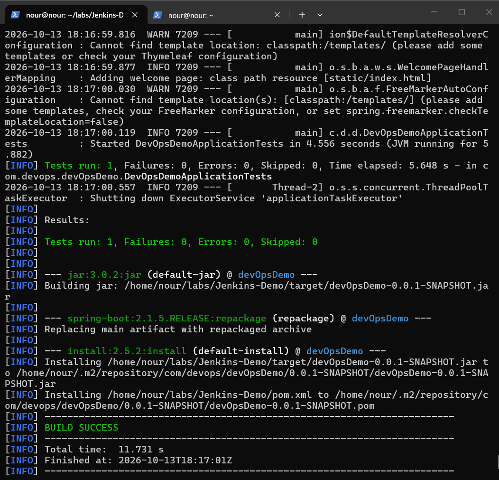
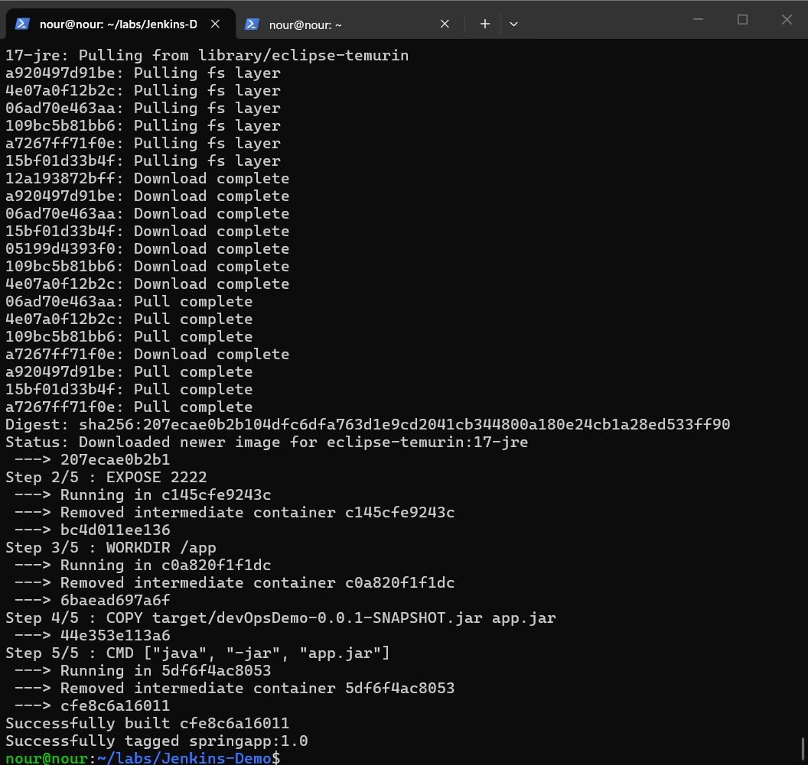
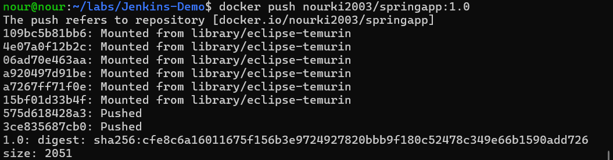
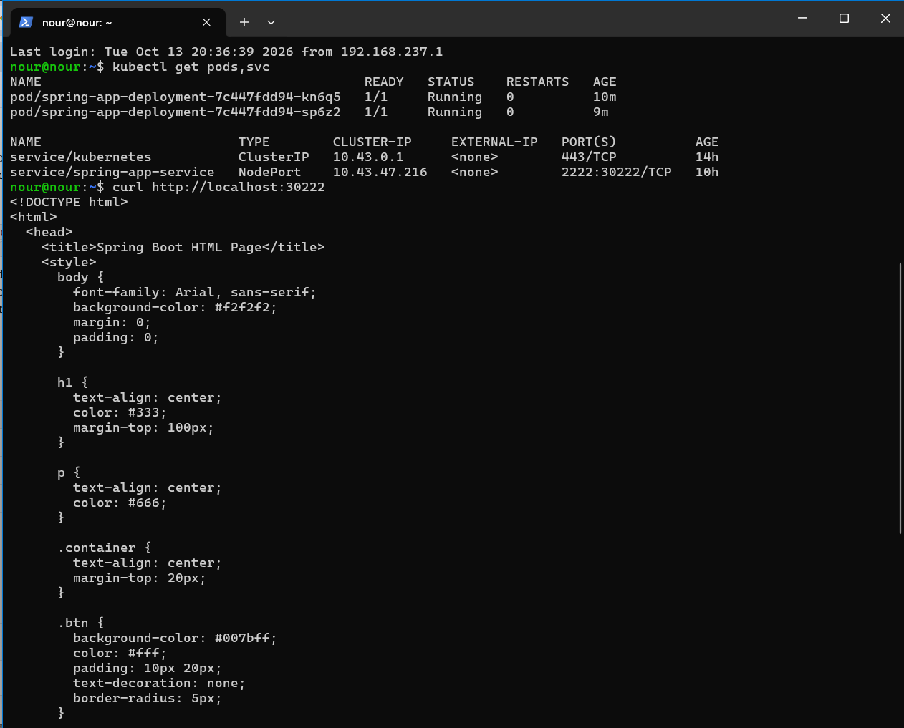
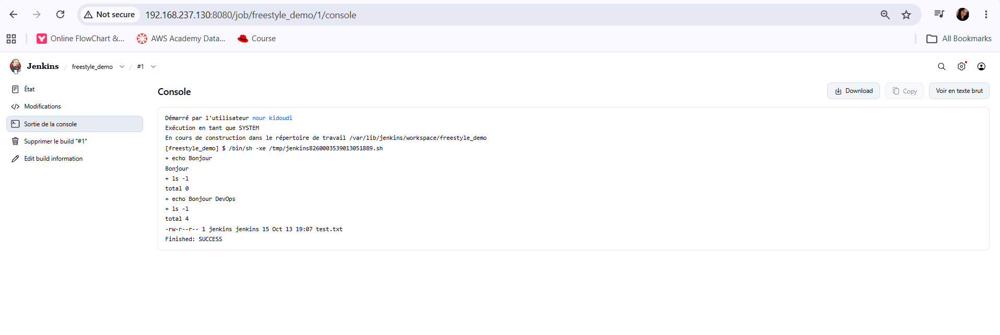
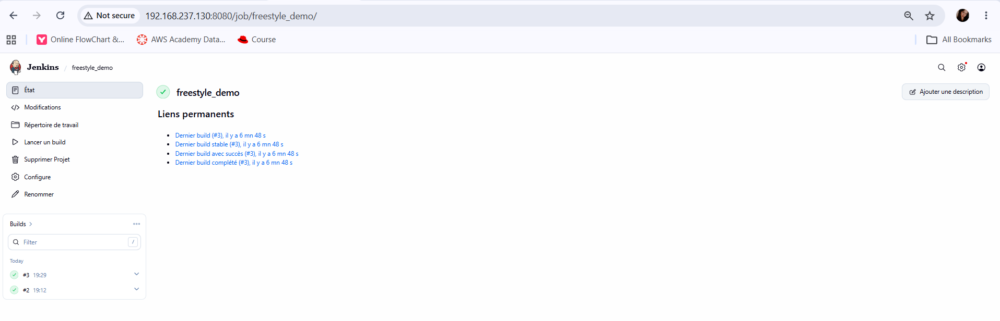
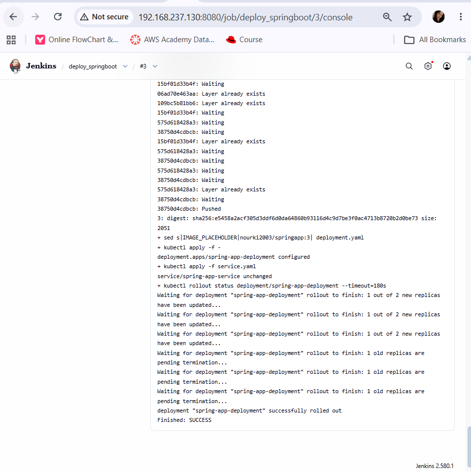
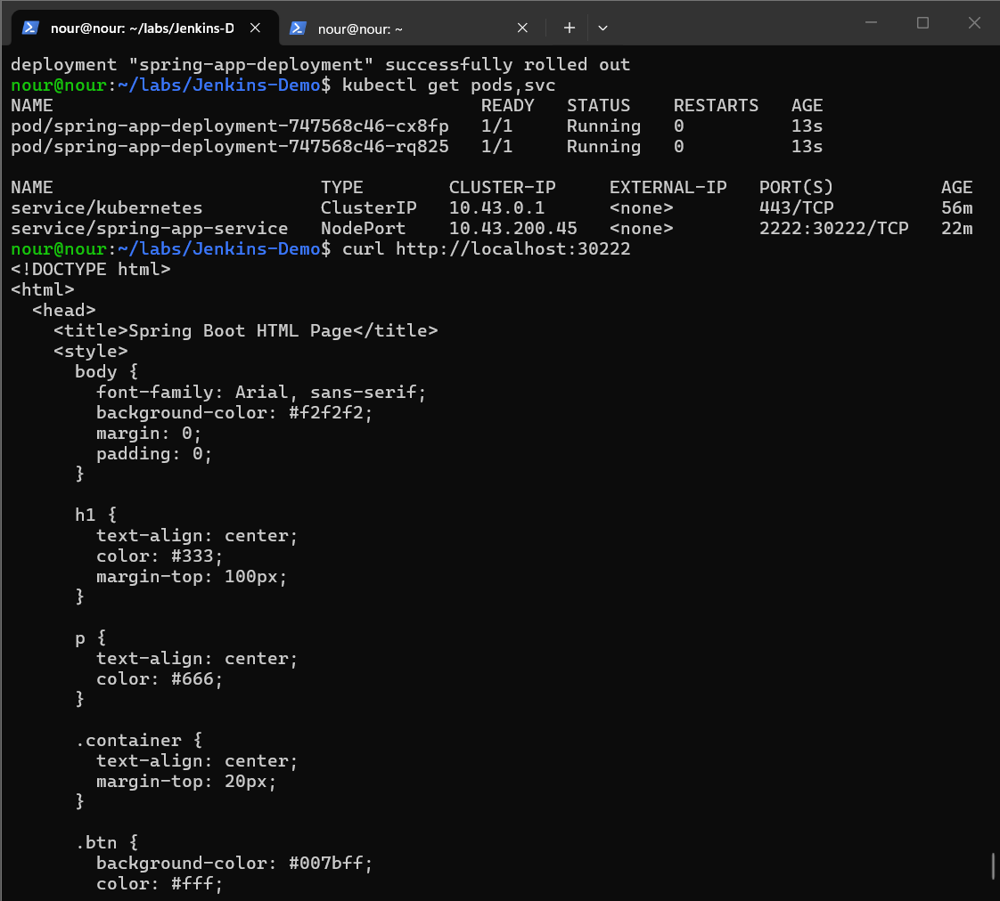
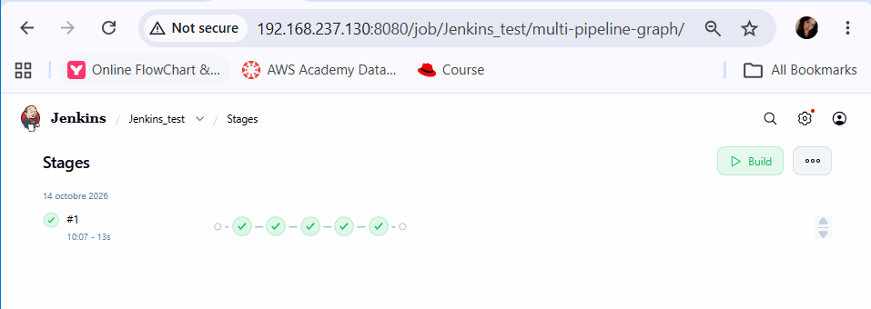
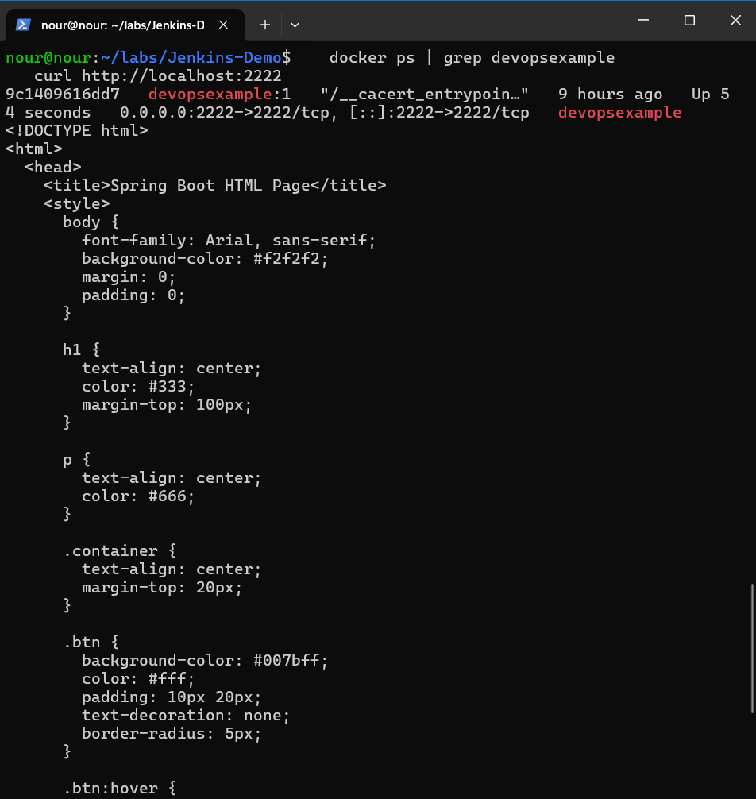

# Comptes rendus – CI/CD avec Jenkins

**Étudiante :** Nour Kidoudi
**Formation :** Master DevOps et Cloud Computing – ISET Tozeur
**Enseignant :** Wahid Hamdi

## Dépôts utilisés

- Application et manifestes Kubernetes : https://github.com/nourkidoudi/Jenkins-Demo
- Script du job Freestyle (Partie II, Step 3) : https://github.com/nourkidoudi/jenkins-freestyle
- Image Docker : `nourki2003/springapp` sur Docker Hub

## Sommaire

- [Lab 1 – Jenkins CI/CD Pipeline](#lab-1--jenkins-cicd-pipeline)
- [Lab 2 – Prise en main et utilisation de Jenkins](#lab-2--prise-en-main-et-utilisation-de-jenkins)
---

# Lab 1 – Jenkins CI/CD Pipeline

## Environnement

- VM Ubuntu Server avec Docker, K3s (Kubernetes) et Jenkins installés
- Java 21, Maven 3.9
- Application : Spring Boot (fork de `wahid007/Jenkins-Demo`), qui écoute sur le port **2222**

---

## I. Workflow manuel (sans Jenkins)

### 1. Construction du projet et de l'image Docker

Dockerfile utilisé :

```dockerfile
FROM eclipse-temurin:17-jre
EXPOSE 2222
WORKDIR /app
COPY target/*.jar app.jar
CMD ["java", "-jar", "app.jar"]
```

Commandes :

```bash
mvn clean install
docker build -t springapp:1.0 .
docker images | grep springapp
```





### 2. Publication sur Docker Hub

```bash
docker login -u nourki2003
docker tag springapp:1.0 nourki2003/springapp:1.0
docker push nourki2003/springapp:1.0
```



### 3. Test du conteneur

```bash
docker run --detach --name myapp --publish 2222:2222 nourki2003/springapp:1.0
curl http://localhost:2222
docker rm -f myapp
```

Les logs confirment que Tomcat démarre sur le port 2222. Un `curl` lancé trop tôt renvoie `Empty reply from server` tant que Spring Boot n'a pas fini de démarrer.

### 4. Déploiement sur K3s avec kubectl

`deployment.yaml` :

```yaml
apiVersion: apps/v1
kind: Deployment
metadata:
  name: spring-app-deployment
spec:
  replicas: 2
  selector:
    matchLabels:
      app: spring-app
  template:
    metadata:
      labels:
        app: spring-app
    spec:
      containers:
        - name: spring-app-container
          image: nourki2003/springapp:1.0
          ports:
            - containerPort: 2222
```

`service.yaml` :

```yaml
apiVersion: v1
kind: Service
metadata:
  name: spring-app-service
spec:
  selector:
    app: spring-app
  ports:
    - protocol: TCP
      port: 2222
      targetPort: 2222
      nodePort: 30222
  type: NodePort
```

```bash
kubectl apply -f deployment.yaml
kubectl apply -f service.yaml
kubectl get pods,svc
curl http://localhost:30222
```



Les 2 pods sont en `Running` et l'application répond sur le NodePort 30222.

---

## II. Jenkins Freestyle

### Préparation : droits de Jenkins

Jenkins doit pouvoir utiliser Docker et kubectl :

```bash
sudo usermod -aG docker jenkins
sudo mkdir -p /var/lib/jenkins/.kube
sudo cp /etc/rancher/k3s/k3s.yaml /var/lib/jenkins/.kube/config
sudo chown -R jenkins:jenkins /var/lib/jenkins/.kube
sudo systemctl restart jenkins
```

### Step 1 – Job `freestyle_demo`

Job de type *Freestyle project* avec l'étape de build *Execute shell* :

```bash
echo 'Bonjour'
ls -l
echo 'Bonjour DevOps' > test.txt
ls -l
```

Le fichier `test.txt` est créé dans `/var/lib/jenkins/workspace/freestyle_demo`.



### Step 2 – Fichier Java

Création de `Test.java` dans le workspace du job, qui affiche **Hi Master DevOps**, puis ajout de la ligne `java Test.java` à la fin du script shell.

```java
public class Test {
    public static void main(String[] args) {
        System.out.println("Hi Master DevOps");
    }
}
```

### Step 3 – Script récupéré depuis GitHub

Le script `script.sh` est stocké dans le dépôt `jenkins-freestyle`. Dans le job : *Source Code Management → Git*, branche `*/main`, et le script shell devient :

```bash
bash script.sh
```


### Step 4 – Déclenchement automatique et rétention

Configuration du job :

- **Build Triggers → Build periodically** : `H/5 * * * *` (toutes les 5 minutes)
- **Discard old builds** : conserver seulement les **2 derniers builds**
- **Delete workspace before build starts** : activé



### Step 5 – Challenge : déploiement automatique sur Kubernetes

Job `deploy_springboot` qui automatise tout, du build au déploiement :

- **Source Code Management :** dépôt `Jenkins-Demo` (fork), branche `*/main`
- **Build Environment :** *Use secret text(s) or file(s)* avec l'identifiant Docker Hub (`DOCKER_USER` / `DOCKER_PASS`)
- **Execute shell :**

```bash
set -e
mvn clean package -DskipTests
IMAGE=$DOCKER_USER/springapp:$BUILD_NUMBER
docker build -t $IMAGE .
echo "$DOCKER_PASS" | docker login -u "$DOCKER_USER" --password-stdin
docker push $IMAGE
sed "s|IMAGE_PLACEHOLDER|$IMAGE|" deployment.yaml | kubectl apply -f -
kubectl apply -f service.yaml
kubectl rollout status deployment/spring-app-deployment --timeout=180s
```

Dans `deployment.yaml` du dépôt, l'image est `IMAGE_PLACEHOLDER` : Jenkins la remplace à chaque build par l'image qu'il vient de construire (`nourki2003/springapp:<numéro du build>`), ce qui force Kubernetes à déployer la nouvelle version.



Vérification sur la VM :

```bash
kubectl get pods,svc
curl http://localhost:30222
```



---

## Problèmes rencontrés et solutions

| Problème | Cause | Solution |
|---|---|---|
| `kubectl` interrogeait Jenkins (« Authentication required ») | Aucun fichier de configuration de cluster : `kubectl` essayait `localhost:8080` | Copie de `/etc/rancher/k3s/k3s.yaml` vers `~/.kube/config` |
| `curl: Empty reply from server` | Spring Boot n'avait pas fini de démarrer | Attendre le message `Tomcat started on port(s): 2222` dans `docker logs` |
| Pods en `InvalidImageName` | Le nom d'image du `deployment.yaml` était invalide (placeholder non remplacé) | Correction de la ligne `image:` puis `kubectl apply` |
| Pod bloqué en `ContainerCreating` | K3s utilise containerd et doit télécharger l'image lui-même | `sudo k3s crictl pull nourki2003/springapp:1.0` puis recréation du déploiement |
| Build Jenkins très lent | Jenkins retéléchargeait toutes les dépendances Maven avec un réseau lent | Copie du cache `~/.m2/repository` vers `/var/lib/jenkins/.m2` |

## Conclusion

Ce lab a permis de construire une chaîne complète pour une application Spring Boot : build Maven, conteneurisation avec Docker, publication sur Docker Hub et déploiement sur K3s, d'abord manuellement, puis automatisé avec un job Jenkins Freestyle qui déclenche tout le processus à partir du code sur GitHub.


---

# Lab 2 – Prise en main et utilisation de Jenkins

## Objectif

Construire un pipeline CI/CD avec un `Jenkinsfile` : clonage du dépôt, build Maven, construction de l'image Docker puis déploiement du conteneur, le tout exécuté par Jenkins.

## 1. Configuration de Jenkins

### Plugins

Plugins utilisés : **Kubernetes CLI**, **Maven Integration**, **Docker** (avec Docker Commons). Le plugin Docker Commons était nécessaire pour faire apparaître la section Docker dans la configuration des outils.

### Outils (Administrer Jenkins → Outils)

Les trois outils sont déclarés avec des chemins locaux, car Java, Maven et Docker sont déjà installés sur la VM :

| Outil | Nom | Chemin |
|---|---|---|
| JDK | `JDK` | `/usr/lib/jvm/java-21-openjdk-amd64` |
| Maven | `maven-3` | `/usr/share/maven` |
| Docker | `MyDocker` | `/usr` |

Le téléchargement automatique (*Install automatically*) a été désactivé : le JDK Oracle demande un compte Oracle, et Maven comme Docker sont déjà présents sur la VM, ce qui évite aussi de longs téléchargements.


## 2. Le Jenkinsfile

Fichier à la racine du dépôt `Jenkins-Demo` (fork). L'ancien `Jenkinsfile` du projet a été conservé sous le nom `Jenkinsfile.original`.

```groovy
node {
    def mvnHome = tool 'maven-3'
    def dockerImageTag = "devopsexample:${env.BUILD_NUMBER}"

    stage('Clone Repo') {
        git branch: 'main', url: 'https://github.com/nourkidoudi/Jenkins-Demo.git'
    }

    stage('Build Project') {
        sh "${mvnHome}/bin/mvn clean package -DskipTests"
    }

    stage('Initialize Docker') {
        def dockerHome = tool 'MyDocker'
        env.PATH = "${dockerHome}/bin:${env.PATH}"
    }

    stage('Build Docker Image') {
        sh "docker build -t ${dockerImageTag} ."
    }

    stage('Deploy Docker Image') {
        echo "Docker Image Tag Name: ${dockerImageTag}"
        sh "docker rm -f devopsexample || true"
        sh "docker run --name devopsexample -d -p 2222:2222 ${dockerImageTag}"
    }
}
```

Explication des stages :

1. **Clone Repo** : récupère le code depuis GitHub.
2. **Build Project** : compile et empaquette l'application avec Maven.
3. **Initialize Docker** : ajoute le dossier de l'outil `MyDocker` au `PATH`.
4. **Build Docker Image** : construit l'image `devopsexample:<numéro du build>`.
5. **Deploy Docker Image** : supprime l'ancien conteneur s'il existe, puis lance le nouveau sur le port 2222.

Le `docker rm -f ... || true` rend le pipeline relançable sans erreur « nom de conteneur déjà utilisé ».

Dockerfile utilisé (celui du Lab 1) :

```dockerfile
FROM eclipse-temurin:17-jre
EXPOSE 2222
WORKDIR /app
COPY target/*.jar app.jar
CMD ["java", "-jar", "app.jar"]
```

## 3. Création du pipeline

Nouveau Item `Jenkins_test`, type **Pipeline** :

- **GitHub project** : `https://github.com/nourkidoudi/Jenkins-Demo`
- **Definition** : *Pipeline script from SCM*
- **SCM** : Git, dépôt `https://github.com/nourkidoudi/Jenkins-Demo.git`, branche `*/main`
- **Script Path** : `Jenkinsfile`

## 4. Exécution

Lancement avec **Lancer un build**. La Stage View affiche tous les stages en vert.



Vérification sur la VM :

```bash
docker ps | grep devopsexample
curl http://localhost:2222
```



L'application répond sur le port 2222.

## Problèmes rencontrés et solutions

| Problème | Cause | Solution |
|---|---|---|
| Section Docker absente dans les outils | Plugin Docker Commons non installé | Installation des plugins Docker puis redémarrage de Jenkins |
| `curl: Failed to connect` sur le port 2222 | Le conteneur était arrêté (`Exited (255)`) après l'extinction de la VM | `docker start devopsexample`, ou relance du pipeline |
| Jenkinsfile de l'énoncé non utilisable tel quel | Guillemets typographiques dans la ligne `git`, Dockerfile avec `COPY ... /app` et `CMD /app.jar` | Syntaxe corrigée, Dockerfile du Lab 1 conservé |

## Conclusion

Le pipeline Jenkins automatise toute la chaîne : récupération du code, build Maven, construction de l'image Docker et déploiement du conteneur. Contrairement au job Freestyle du Lab 1, tout le processus est décrit dans un `Jenkinsfile` versionné avec le code.
